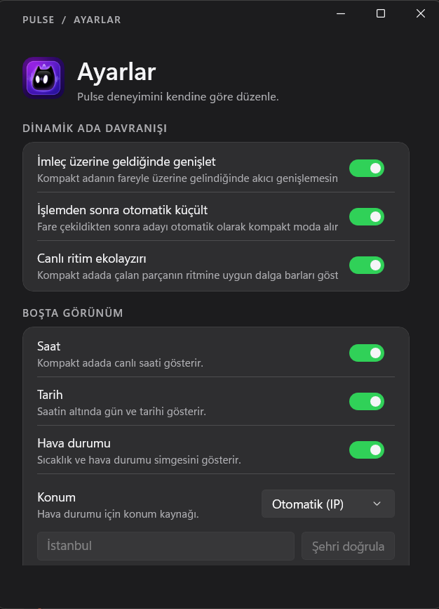

<div align="center">

# Pulse

**A Fluid, Apple iOS Dynamic Island & Media Dashboard for Windows 11**

[](https://dotnet.microsoft.com/)
[](https://learn.microsoft.com/en-us/windows/apps/winui/winui3/)
[](https://github.com/microsoft/windowsappsdk)
[](LICENSE)

*Pulse brings a sleek, interactive, micro-animated Dynamic Island experience to your Windows desktop, with native system media control, live album art, a Pomodoro focus timer, system monitoring controls, fluid dark/light theme adaptability, and a smart idle strip for the time, date and local weather.*

---


<em>Compact state: live track pill with album art, title, artist and playback control.</em>


<em>Expanded media panel: album art, seek timeline, synced lyrics (current + upcoming line) and Apple-style transport controls. Tap the artwork to jump to the source app.</em>


<em>Focus timer panel: Pomodoro presets (25/50 min work, 5/15 min break), tabular countdown digits and a spring-animated progress hairline.</em>


<em>System panel: monochrome volume control with mute state, live battery status and one-click screenshot capture.</em>



<em>Settings: dark, light and system themes with live transitions, motion profiles plus a 70-140% speed slider, artwork tint strength, glass transparency and layout controls.</em>

---

</div>

## Key Features

- **Dynamic Island UI**: Floating, top-aligned desktop widget with multi-state transitions (Idle, Compact, Hover, Expanded, Track Change pulse).
- **Smart Idle Strip**: When no media is playing, the compact pill shows a live clock, Turkish date and local weather side by side. Weather uses Open-Meteo (no API key) and refreshes every 15 minutes; location comes from an approximate IP lookup or a manually verified city. Clock, date and weather can each be hidden. Automatic mode sends the public IP to `ipwho.is`; weather coordinates go to Open-Meteo.
- **Fully Configurable Appearance**: Dark/Light/System themes, glass transparency (0-100%), artwork tint strength (0-100%), motion profile and speed (70-140%), island scale and top offset are all live-adjustable from Settings, along with idle clock/date/weather toggles and a manual city override.
- **Live Media Session Control**: Synchronizes automatically with Windows System Media Transport Controls (GSMTC) for Spotify, Apple Music, YouTube, browsers, VLC and more.
- **Album Art & Adaptive Theming**: Dynamic artwork extraction, caching, accent-color sampling and adjustable tint strength (0-100%) across dark, light and system themes.
- **Interactive Timeline & Seeking**: Real-time progress with drag-to-seek support and ±15s skip controls, laid out like Apple's expanded Live Activity.
- **Liquid-Glass Frost Effect**: Toggleable glass mode with a 0-100% transparency slider that samples and blurs the live desktop behind the island, then layers the current album-art tint on top for a true frosted-glass look.
- **Focus Timer (Pomodoro)**: Preset work/break chips (25/50, 5/15 minutes), live countdown, session auto-switching that keeps the island pinned while a session runs.
- **System Controls Panel**: Master volume with integer stepping and visual mute state, live battery telemetry (charging/level states), and instant screenshot capture that saves locally and copies to the clipboard.
- **Avatar Pulse (Track Change)**: Smooth scale-in/out micro animations on track changes, plus layout snap animations.
- **Tap to Open (Deep Link)**: Tap the album artwork in the island to jump straight to the app that owns the playback (Spotify, browser, any GSMTC source). Notification and download capsules open their related file or folder.
- **Real Event Awareness**: Live AC/charging detection (plug the charger and the island reacts even at 100%), external volume-change HUD (hardware keys), and a Downloads watcher that surfaces completed downloads.
- **Apple-Style Alert Takeover**: Incoming alerts briefly take over the presentation and then hand back to the current activity.
- **Single-Instance Launch Guard**: Re-launching Pulse never spawns a broken second copy - the running island surfaces (and expands) instead.
- **Alive Controls**: Every island button has hover, pressed and disabled feedback; the focus countdown uses tabular digits and an animated progress hairline.
- **Synced Lyrics**: lrclib-backed word-timed lyrics shown in the expanded media panel with graceful query fallbacks (album/duration drift tolerant).
- **Global Hotkeys**: Win+Alt+I shows/hides the island; Win+Shift+F starts or pauses the focus timer from anywhere.
- **Spring Motion Profiles**: expand/collapse runs on a damped harmonic spring; the motion-intensity setting (Minimal/Balanced/Fluid) plus a 70-140% speed slider changes damping and duration for real.
- **Notification Controls**: Per-category toggles in Settings for the audio HUD, power/charging alerts and download notifications.
- **Reduced Motion**: Respects the Windows animation-effects setting - motion is disabled instantly when the OS asks for it.
- **Unstealable Topmost**: z-order changes are forced back to topmost in WM_WINDOWPOSCHANGING, so the island can never be buried by other apps.
- **System Tray Integration**: Unobtrusive background operation with quick access menu, media controls, startup toggle and quick exit.
- **Multi-Monitor & DPI Aware**: Adapts to DPI scale factors and monitor layouts per cursor position without clipping or blurred rendering.
- **Unit Tested Architecture**: Clean MVVM architecture with platform-decoupled state machine and weather/location coverage (107 automated tests).

---

## Architecture & Technology Stack

- **Framework**: .NET 9.0 / C# 13
- **UI Platform**: WinUI 3 (Windows App SDK 2.5.1, unpackaged & self-contained deployment)
- **Effects**: Microsoft Composition (Spring/Fluid animations), DWM-backed transparent window surfaces, GDI-based frosted-desktop sampling
- **Media API**: `Windows.Media.Control.GlobalSystemMediaTransportControlsSessionManager`
- **Weather & Location**: Open-Meteo current conditions and geocoding, ipwho.is IP lookup, JSON disk caches
- **System APIs**: WASAPI endpoint volume, Win32 power status (`GetSystemPowerStatus`), GDI screen capture
- **MVVM Pattern**: `CommunityToolkit.Mvvm`
- **Testing**: xUnit with Moq

---

## Screens Flow

The island exposes three pages while expanded. Switch pages by scrolling the mouse wheel over the expanded panel.

1. **Media** - playback, timeline and transport controls.
2. **Focus Timer** - Pomodoro focus timer with preset chips.
3. **System & Control** - master volume, battery status, screenshot capture.

When nothing is playing, the compact pill switches to the smart idle strip: clock and date on the left, local weather on the right. The wordmark remains as a fallback when all idle information is disabled or unavailable.

Clicking the collapsed pill expands the island; clicking outside (or the collapse arrow) returns it to the compact state. The island can be hidden from the tray or the right-click menu and restored later.

---

## Getting Started

### Prerequisites

1. **Windows 10/11** (Build 19041 or newer, recommended Build 26100+)
2. **.NET 9.0 SDK** ([Download .NET 9](https://dotnet.microsoft.com/download/dotnet/9.0))

No Developer Mode or Windows App Runtime installation is required; the app ships as an unpackaged, self-contained executable.

### Building & Running

Clone the repository and build using the .NET CLI:

```powershell
# Clone the repository
git clone https://github.com/sandrotonal/pulse.git
cd pulse

# Build the solution
dotnet build Pulse.sln

# Run unit tests
dotnet test Pulse.sln

# Run the app
dotnet run --project src/Pulse/Pulse.csproj
```

To launch the compiled binary directly:

```powershell
.\src\Pulse\bin\x64\Debug\net9.0-windows10.0.26100.0\win-x64\Pulse.exe
```

If the app was previously running, stop existing instances first:

```powershell
Stop-Process -Name Pulse -Force -ErrorAction SilentlyContinue
```

---

## Usage & Controls

- **Mouse Wheel**: change pages (Media, Focus Timer, System Controls) while expanded.
- **Click Pill**: toggle the expanded dashboard.
- **Hotkeys**: Win+Alt+I toggles the island, Win+Shift+F toggles the focus timer.
- **Click Artwork**: open the app that is currently playing (deep link to Spotify/browser/VLC etc.).
- **Click Alert Capsule**: open the related target (screenshot file, downloads folder, focus panel).
- **Hover**: quick state (media wave animation, track details).
- **Right Click / System Tray**: settings panel, focus timer shortcuts, notification simulator, taskbar flyout, hide island.
- **Idle Settings**: toggle the idle clock, date and weather; use automatic IP location or verify a manual city. Weather refreshes every 15 minutes.
- **Dynamic Tinting**: album art driven accent changes blended into pill backgrounds and controls.
- **Slider (System Page)**: stepwise master volume; mute button shows a red active state.

---

## Repository Structure

```
pulse/
├── src/
│   └── Pulse/                      # Main WinUI 3 Application
│       ├── Components/             # UI Views, Dynamic Island Controls
│       ├── Views/                  # Island window and Settings window
│       ├── Core/                   # Platform-neutral services & contracts
│       ├── Services/               # Media Session, System Tray, Settings
│       ├── ViewModels/             # MVVM ViewModels
│       ├── Helpers/                # Win32 Interop, Windowing & Animation helpers
│       └── Assets/                 # App icons and graphics
├── tests/
│   └── Pulse.Tests/                # xUnit Automated Tests
├── docs/
│   └── images/                     # README screenshots
├── Pulse.sln                       # Visual Studio / .NET Solution
└── README.md
```

---

## Contributing

Contributions are always welcome. Feel free to open issues, submit pull requests, or request new features.

1. Fork the Project
2. Create your Feature Branch (`git checkout -b feature/AmazingFeature`)
3. Commit your Changes (`git commit -m 'Add some AmazingFeature'`)
4. Push to the Branch (`git push origin feature/AmazingFeature`)
5. Open a Pull Request

---

## License

Distributed under the MIT License. See `LICENSE` for more information.
