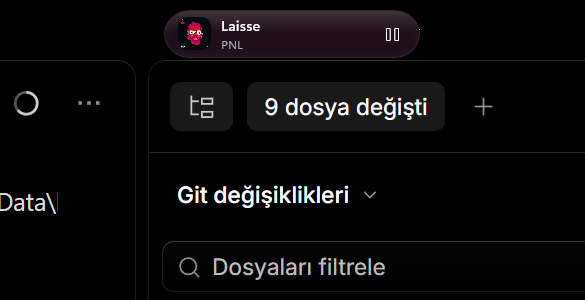
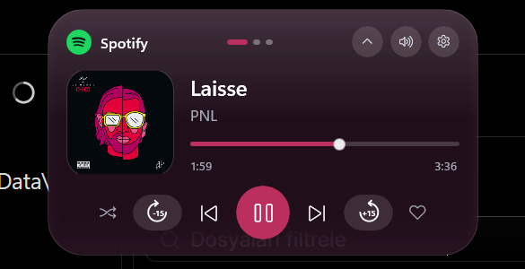
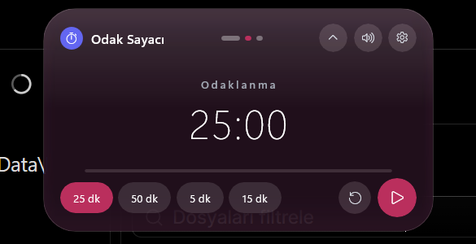
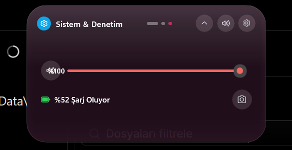

<div align="center">

# Pulse

**A Fluid, Apple iOS Dynamic Island & Media Dashboard for Windows 11**

[](https://dotnet.microsoft.com/)
[](https://learn.microsoft.com/en-us/windows/apps/winui/winui3/)
[](https://github.com/microsoft/windowsappsdk)
[](LICENSE)

*Pulse brings a sleek, interactive, micro-animated Dynamic Island experience to your Windows desktop, with native system media control, live album art, a Pomodoro focus timer, system monitoring controls, and fluid dark/light theme adaptability.*

---



<em>Compact state: live track pill with album art, title, artist and playback control.</em>



<em>Expanded media panel: album art, seek timeline, transport controls, adaptive accent colors.</em>



<em>Focus timer panel: Pomodoro presets (25/50 min work, 5/15 min break) with one-tap start.</em>



<em>System panel: master volume with mute state, livebattery status, one-click screenshot capture.</em>

---

</div>

## Key Features

- **Dynamic Island UI**: Floating, top-aligned desktop widget with multi-state transitions (Idle, Compact, Hover, Expanded, Track Change pulse).
- **Live Media Session Control**: Synchronizes automatically with Windows System Media Transport Controls (GSMTC) for Spotify, Apple Music, YouTube, browsers, VLC and more.
- **Album Art & Adaptive Theming**: Dynamic artwork extraction, caching, accent-color sampling and pre-blended color tinting across both dark and light themes.
- **Interactive Timeline & Seeking**: Real-time progress with drag-to-seek support, skip ±15s, shuffle and like controls.
- **Liquid-Glass Frost Effect**: Optional transparency mode that samples and blurs the live desktop behind the island for a true frosted-glass look.
- **Focus Timer (Pomodoro)**: Preset work/break chips (25/50, 5/15 minutes), live countdown, session auto-switching that keeps the island pinned while a session runs.
- **System Controls Panel**: Master volume with integer stepping and visual mute state, live battery telemetry (charging/level states), and instant screenshot capture that saves locally and copies to the clipboard.
- **Avatar Pulse (Track Change)**: Smooth scale-in/out micro animations on track changes, plus layout snap animations.
- **System Tray Integration**: Unobtrusive background operation with quick access menu, media controls, startup toggle and quick exit.
- **Multi-Monitor & DPI Aware**: Adapts to DPI scale factors and monitor layouts per cursor position without clipping or blurred rendering.
- **Unit Tested Architecture**: Clean MVVM architecture with platform-decoupled state machine test coverage (39 automated tests).

---

## Architecture & Technology Stack

- **Framework**: .NET 9.0 / C# 13
- **UI Platform**: WinUI 3 (Windows App SDK 2.5.1, unpackaged & self-contained deployment)
- **Effects**: Microsoft Composition (Spring/Fluid animations), DWM-blended acrylic panels, GDI-based frosted-desktop sampling
- **Media API**: `Windows.Media.Control.GlobalSystemMediaTransportControlsSessionManager`
- **System APIs**: WASAPI endpoint volume, Win32 power status (`GetSystemPowerStatus`), GDI screen capture
- **MVVM Pattern**: `CommunityToolkit.Mvvm`
- **Testing**: xUnit with Moq

---

## Screens Flow

The island exposes three pages while expanded. Switch pages by scrolling the mouse wheel over the expanded panel.

1. **Media** - playback, timeline and transport controls.
2. **Focus Timer** - Pomodoro focus timer with preset chips.
3. **System & Control** - master volume, battery status, screenshot capture.

Clicking the collapsed pill expands the island; clicking outside (or the collapse arrow) returns it to the compact state. The island can be hidden from the tray or the right-click menu and restored later.

---

## Getting Started

### Prerequisites

1. **Windows 10/11** (Build 19041 or newer, recommended Build 26100+)
2. **.NET 9.0 SDK** ([Download .NET 9](https://dotnet.microsoft.com/download/dotnet/9.0))

No Developer Mode or Windows App Runtime installation is required; the app ships as an unpackaged, self-contained executable.

### Building & Running

Clone the repository and build using the .NET CLI:

```powershell
# Clone the repository
git clone https://github.com/sandrotonal/pulse.git
cd pulse

# Build the solution
dotnet build Pulse.sln

# Run unit tests
dotnet test Pulse.sln

# Run the app
dotnet run --project src/Pulse/Pulse.csproj
```

To launch the compiled binary directly:

```powershell
.\src\Pulse\bin\x64\Debug\net9.0-windows10.0.26100.0\win-x64\Pulse.exe
```

If the app was previously running, stop existing instances first:

```powershell
Stop-Process -Name Pulse -Force -ErrorAction SilentlyContinue
```

---

## Usage & Controls

- **Mouse Wheel**: change pages (Media, Focus Timer, System Controls) while expanded.
- **Click Pill**: toggle the expanded dashboard.
- **Hover**: quick state (media wave animation, track details).
- **Right Click / System Tray**: settings panel, focus timer shortcuts, notification simulator, taskbar flyout, hide island.
- **Dynamic Tinting**: album art driven accent changes blended into pill backgrounds and controls.
- **Slider (System Page)**: stepwise master volume; mute button shows a red active state.

---

## Repository Structure

```
pulse/
├── src/
│   └── Pulse/                      # Main WinUI 3 Application
│       ├── Components/             # UI Views, Dynamic Island Controls
│       ├── Views/                  # Island window and Settings window
│       ├── Core/                   # Platform-neutral services & contracts
│       ├── Services/               # Media Session, System Tray, Settings
│       ├── ViewModels/             # MVVM ViewModels
│       ├── Helpers/                # Win32 Interop, Windowing & Animation helpers
│       └── Assets/                 # App icons and graphics
├── tests/
│   └── Pulse.Tests/                # xUnit Automated Tests
├── docs/
│   └── images/                     # README screenshots
├── Pulse.sln                       # Visual Studio / .NET Solution
└── README.md
```

---

## Contributing

Contributions are always welcome. Feel free to open issues, submit pull requests, or request new features.

1. Fork the Project
2. Create your Feature Branch (`git checkout -b feature/AmazingFeature`)
3. Commit your Changes (`git commit -m 'Add some AmazingFeature'`)
4. Push to the Branch (`git push origin feature/AmazingFeature`)
5. Open a Pull Request

---

## License

Distributed under the MIT License. See `LICENSE` for more information.
